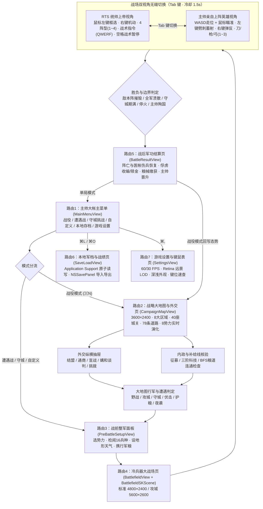

# 《火柴人冷兵器大战》（Stickman Cold Steel War for macOS）游戏总体设计文档（DESIGN.md）

- **目标平台**：macOS 原生桌面应用（**macOS 14 Sonoma+**，**Apple Silicon (M1/M2/M3/M4 `arm64`) 优先**，纯单机离线运行，零联网依赖、零付费 SDK、严禁 Electron / Web 套壳）
- **技术栈**：**Swift 6（Strict Concurrency Complete） + SwiftUI + SpriteKit + AppKit**，Xcode 16，XCTest 独立单元测试
- **设计基准与跨端一致性声明**：本设计文档完整移植自鸿蒙版 `../stickman-war/DESIGN.md` 与 `GAME_BRIEF.md`，**核心玩法、三维资源、16 种兵种数值、双曲护甲与反骑公式、8 大非对称势力、外交媾和与背盟铁律、三层 AI 战术及四大极端边界闭环 100% 与鸿蒙版同源对齐**，仅将触屏交互、渲染管线、窗口菜单与本地存档替换为纯正 macOS 原生实现。
- **城关节点数权威口径说明**：`MAC_BRIEF.md` 初稿写为“36 座城池/关隘”，而鸿蒙版最新 `DESIGN.md` 已升级配平为 **8 大地理板块、每势力开局公平坐拥 5 座城关，全图共 40 座城关节点、78 条对称无向道路连接**——**本 macOS 版严格以鸿蒙版最新 `DESIGN.md` 的 40 节点、78 条道路为唯一权威标准**（详见第七节与 `StickmanWar/Config/CampaignMapConfig.swift`）。
- **一句话核心体验**：玩家化身冷兵器时代的一军统帅，在 Mac 大屏 **4800×2400（攻城 5600×2600）宏大战场**上用键鼠框选百人方阵排兵布阵、调度粮草、侧翼包抄，也能随时按下 **`Tab` 键提刀上阵**（`WASD` 走位 + 鼠标瞄准劈砍/格挡弹反/蓄力狙杀）冲入敌阵斩将夺旗；在 **8 大区域、40 座城关、78 条粮道**构成的战略大地图上，与其余 **7 大特色势力**展开攻城略地、粮道截断、合纵连横的真实冷兵器战争博弈。

---

## 一、核心玩法闭环、七大页面路由与 macOS 原生差异总览

### 1.1 三层战争体验闭环与 7 大核心页面路由
游戏由**战略层（大地图战役与外交）**、**指挥层（RTS 实时键鼠战术调度）**与**动作层（主帅英雄亲自上阵）**三层体验无缝咬合，对应 `AppRoute` 枚举的 **7 个核心页面路由**：



### 1.2 macOS 原生版五大核心平台差异说明（对比鸿蒙平板触控版）
| 维度 | 鸿蒙 HarmonyOS NEXT 版 | macOS 原生版（本项目） |
| :--- | :--- | :--- |
| **输入操控体系** | 双指捏合缩放、触屏拖拽框选、主帅模式左下角虚拟摇杆 + 右下角触控技能圆盘 | **纯正 Mac 键鼠 + 触控板手势**：RTS 左键点选/框选、右键下令、`Space` 战术暂停下令；英雄模式彻底摒弃虚拟摇杆，改用 **`WASD` 八向走位 + 鼠标光标实时瞄准 + 左右键攻防**；支持 Mac 触控板双指平移与 `magnify` 双指捏合缩放 |
| **战场渲染引擎** | ArkUI Canvas 2D 同色路径 `ctx.stroke()` 合批 | **Apple Silicon Metal 加速 `SpriteKit` (`SKScene` + `SKCameraNode`)**：预烘焙 Retina 肢体/兵刃纹理图集（`SKTexture`），依托 `SKSpriteNode` 硬件自动合批（Auto-Batching），严禁每帧重建 `SKShapeNode` 几何路径 |
| **界面与状态框架** | ArkTS Stage 模型 `@Entry @Component` + Router | **Swift 6 + SwiftUI (`@MainActor @Observable`)**：双栏 `HSplitView` 桌面战情室布局，支持窗口自由缩放（最小 `1180×740`，默认 `1440×900`）、原生全屏（`⌃⌘F`）、Retina 2x 高分屏与深色/浅色模式 |
| **系统菜单栏** | 无桌面级顶部菜单栏 | **AppKit / SwiftUI `Commands` 原生顶部菜单栏**：完整提供应用设置（`⌘,`）、文件菜单（新建战役 `⌘N` / 遭遇战 `⇧⌘N` / 导入导出存档 `⌘O`、`⇧⌘S`）、视图路由（`⌘1~⌘4`）与帮助速查（`⌘/`） |
| **本地存档机制** | HarmonyOS 应用沙箱 `EntryBackupAbility` | **`~/Library/Application Support/StickmanColdSteelWar/Saves/` 原子 JSON 持久化** + AppKit 原生 `NSSavePanel` / `NSOpenPanel` 文件对话框备份导出与导入；沙箱 `StickmanWar.entitlements` 显式关闭一切网络权限 |

---

## 二、三维资源、战场采集与后勤粮道设计

### 2.1 三种核心资源
| 资源类型 | 战场内获取方式 | 战役大地图获取方式 | 核心用途 | 耗尽后果 |
| :--- | :--- | :--- | :--- | :--- |
| **金币 (Gold)** | 辎重工兵开采野外金矿脉并运回大营；劫掠敌营 | 城池税赋、矿山产出、丝路通商协定、战争赔款 | 招募精锐兵种、研发三阶科技、外交送礼/求和、商盟雇佣军 | 无法招募高阶兵种；沙漠商盟外籍雇佣兵士气持续下滑 |
| **木材 (Wood)** | 辎重工兵砍伐野外林场运回 | 林场重镇产出、战后拆解缴获 | 制造弓弩、长枪、连弩车、投石车，修筑拒马/箭塔/简易云梯 | 无法补充远程攻城器械与战场防御工事 |
| **粮草 (Grain)** | 战前自仓城携行（标准 `1200`）+ 工兵抢收农庄/劫掠敌粮车 | 丰穗仓城/绿洲农牧产出、附庸纳贡 | 招募士兵口粮、**全军每秒维持消耗**、大地图远征 | **触发【断粮】三级递进惩罚（掉移速、停回士气、饥溃逃散）** |

### 2.2 战场工兵与本阵警钟机制（快捷键 `B`）
- 战场除左右双方本阵大营外，在南北侧翼走廊分布有**野外金矿、林木区、农庄粮垛**。外派【辎重工兵】采集效率高于大营保底产出，但暴露在敌方游骑兵绕后袭扰风险之下。
- **本阵警钟（Garrison Bell，快捷键 `B`）**：遭遇敌骑偷家时一键敲响大营警钟，附近工兵立即暂停采集退入大营围栏内，通过营寨射击孔投石/短弓协防；危机解除后再按 `B` 一键出营复工。

---

## 三、全兵种数值体系与克制数学模型（共 16 种：8 通用 + 8 专属）

### 3.1 核心伤害、双曲护甲、盾防与反骑动能破甲公式
统一采用可单测断言、杜绝后期免伤或刮痧死局的**双曲护甲减伤模型（$K = 50$）**：

1. **有效护甲**：
   $$A_{\text{eff}} = \max\bigl(0,\; A_{\text{target}} \times (1 - \text{Pen}_{\text{attacker}})\bigr)$$
2. **护甲减伤率**：
   $$\text{Mitigation}(A_{\text{eff}}) = \frac{A_{\text{eff}}}{A_{\text{eff}} + 50}$$
   > 物理含义：$A_{\text{eff}} = 50$ 时减伤 $50\%$（等效生命 $2\times$）；每增加 $50$ 点有效护甲线性增加 $100\%$ 基础等效生命，绝不出现 $100\%$ 免伤死局。
3. **远程正面盾牌格挡**（仅当受击方正面朝向箭矢来袭夹角 $\le 60^\circ$ 时全额生效；侧射 $60^\circ \sim 135^\circ$ 减半；背射 $> 135^\circ$ 为 $0$）：
   $$M_{\text{shield}} = 1 - \text{ShieldBlock}_{\text{target}}$$
4. **单次最终伤害**：
   $$\text{Damage} = \max\Bigl(2,\; \text{Atk} \times M_{\text{charge}} \times M_{\text{antiCav}} \times M_{\text{flank}} \times M_{\text{terrain}} \times M_{\text{morale}} \times M_{\text{shield}} \times \bigl(1 - \text{Mitigation}(A_{\text{eff}})\bigr)\Bigr)$$
   - **冲锋倍率 $M_{\text{charge}}$**：骑兵/突击兵连续直线加速满 $2.5\text{s}$（移速达峰值 $85\%$ 以上）接敌首击触发 `chargeMultiplier`，随后进入 $8.0\text{s}$ 冲锋重整冷却。
   - **反骑倍率 $M_{\text{antiCav}}$ 与动能破甲**：长枪/戟兵处于**非溃逃、非奔跑冲锋**且正面迎向冲锋态骑兵时，触发 `antiCavalryMultiplier`（长枪方阵兵高达 $3.2\times$），且借助敌马高速冲撞动能额外获得 **$+30\%$ 临时破甲率**（确保重装铁浮图正撞枪阵同样遭受毁灭性穿刺），并强制清空骑兵冲锋动量停马！

### 3.2 八种全势力通用基础兵种数值表（与 `UnitConfig.swift` 严格一致）

| 兵种名称 | 定位 | HP | 攻击 | 破甲 | 护甲 | 盾远程减伤 | 射程 (盲区) | 攻速间隔 | 移速 | 冲锋 / 反骑 | 花费 (金/木/粮) | 训练 / 人口 / 秒耗粮 | 核心战术机制 |
| :--- | :--- | :---: | :---: | :---: | :---: | :---: | :---: | :---: | :---: | :---: | :---: | :---: | :--- |
| **辎重工兵** | 后勤辅兵 | 90 | 8 | 5% | 5 | 0% | 22 (0) | 1.40s | 68 | 1.00 / 1.0 | 35 / 10 / 15 | 5s / 1 / 0.05 | 采集金木粮、修筑拒马箭塔、抢修器械；鸣钟(`B`)入营协防 |
| **刀盾步兵** | 抗线步兵 | 220 | 18 | 15% | 45 | **55%** | 26 (0) | 1.15s | 62 | 1.10 / 1.0 | 65 / 15 / 30 | 7s / 1 / 0.10 | 高盾防正面顶箭雨稳住战线；克弓手轻步，惧破甲巨斧 |
| **长枪方阵兵** | 反骑长柄 | 185 | 20 | 25% | 28 | 0% | **48** (0) | 1.25s | 58 | 1.00 / **3.2** | 55 / 30 / 30 | 7s / 1 / 0.10 | 双排叠刺，正面架枪迎骑享 320% 伤害 +30% 破甲并停马；怕箭雨 |
| **复合弓手** | 曲射远程 | 115 | 17 | 15% | 10 | 0% | **360** (45) | 1.50s | 66 | 1.00 / 1.0 | 60 / 35 / 25 | 8s / 1 / 0.09 | 抛射越过友军杀伤无盾目标，高地射程 +20%；被骑兵近身秒切 |
| **游骑兵** | 机动轻骑 | 250 | 24 | 20% | 26 | 15% | 30 (0) | 1.10s | **118** | **2.10** / 1.0 | 125 / 20 / 65 | 11s / 2 / 0.22 | 580px 大视野侦察开图，高速绕后切弓手器械粮车；严禁撞枪阵 |
| **重型巨斧兵** | 破甲突击 | 205 | 34 | **65%** | 30 | 0% | 30 (0) | 1.55s | 57 | 1.35 / 1.15 | 95 / 25 / 40 | 9s / 1 / 0.14 | 无视 65% 护甲+半圆横扫溅射，专拆重甲刀盾与木质城门 |
| **破甲连弩车** | 反甲器械 | 320 | 72 | **75%** | 22 | 0% | **540** (90) | 3.40s | 38 | 1.00 / 1.4 | 180 / 140 / 45 | 16s / 3 / 0.18 | 平射重型钢箭直线贯穿 3 人，专杀具装重骑与巨熊巨人 |
| **配重投石车** | 攻城重器 | 380 | 125 | 60% | 18 | 0% | **880** (220) | 6.20s | 28 | 1.00 / 1.0 | 240 / 210 / 60 | 20s / 4 / 0.24 | 超远面杀伤+对建筑 350% 伤害+砸崩密集阵士气；220px 盲区大 |

### 3.3 八大势力专属王牌兵种数值表

| 专属兵种 | 所属势力 | HP | 攻击 | 破甲 | 护甲 | 盾防 | 射程 (盲区) | 攻速间隔 | 移速 | 冲锋 / 反骑 | 花费 (金/木/粮) | 训练 / 人口 / 秒耗粮 | 独有标志机制 |
| :--- | :--- | :---: | :---: | :---: | :---: | :---: | :---: | :---: | :---: | :---: | :---: | :---: | :--- |
| **炎龙神机重卫** | 炎龙帝国 | 335 | 32 | 45% | **62** | 40% | 38 (0) | 1.25s | 54 | 1.15 / **2.2** | 135 / 35 / 55 | 12s / 2 / 0.18 | 接敌前投掷震天火雷破阵并炸降敌军士气 -12，重甲反骑兼备 |
| **苍狼怯薛骑射** | 苍狼汗国 | 250 | 26 | 30% | 24 | 10% | **310** (0) | 1.30s | **124** | 1.65 / 1.0 | 145 / 45 / 65 | 12s / 2 / 0.20 | 支持“曼古歹”边退边射无盲区风筝重步，残局拔弯刀冲锋追斩 |
| **铁鹰重装神弩手** | 铁鹰王国 | 165 | 36 | **55%** | 32 | **60%** | **420** (50) | 2.35s | 56 | 1.00 / 1.1 | 110 / 55 / 35 | 10s / 1 / 0.12 | 钢弩高破甲直穿重甲；换弹期自动转身背大盾减免 60% 箭伤 |
| **黄金马穆鲁克卫队** | 沙漠商盟 | 310 | 28 | 35% | 44 | 35% | 34 (0) | 1.15s | 104 | 1.85 / **1.9** | 175 / 20 / 60 | 11s / 2 / 0.19 | 披甲骆驼气味惊马光环：160px 内敌方战马移速与冲锋伤 -25% |
| **霜原巨熊破阵者** | 霜原熊族 | **620** | **66** | **70%** | 42 | 0% | 38 (0) | 1.75s | 60 | 1.50 / 1.4 | 185 / 45 / 95 | 14s / 3 / 0.30 | 1.35 倍巨人身躯免疫普通击退，重锤扇形震飞前排，正面霸主 |
| **雾林影袭神射** | 雾林猎手 | 135 | 31 | 45% | 14 | 0% | **430** (30) | 1.55s | 78 | 1.00 / 1.0 | 115 / 50 / 35 | 10s / 1 / 0.11 | 密林/脱战 4s 潜行隐身，破隐首箭 180% 暴击并附带 3s 毒伤减速 |
| **玄甲具装铁浮图** | 玄甲重骑 | 420 | 38 | 45% | **68** | 45% | 36 (0) | 1.25s | 98 | **2.65** / 1.2 | 215 / 35 / 95 | 16s / 3 / 0.34 | 超高甲抗箭，冲锋可凿穿首层薄弱步兵直踏后排；惧拒马泥泞断粮 |
| **血月狂战祭团** | 血月祭司 | 160 | 26 | 40% | 4 | 0% | 28 (0) | **1.00s** | 78 | 1.45 / 1.0 | 85 / 15 / 45 | 8s / 1 / 0.12 | 战鼓锁士气 ≥50 不溃；损血加攻速且近战吸血，无甲极惧弓弩 |

### 3.4 兵种闭环克制关系
- **刀盾步兵** 顶盾克制 **复合弓手** $\rightarrow$ **复合弓手** 齐射克制无盾 **长枪兵 / 巨斧兵 / 狂战士**
- **长枪方阵兵** 正面架枪克制 **游骑兵 / 具装重骑** $\rightarrow$ **骑兵** 高速绕后克制 **弓弩手 / 投石车 / 工兵**
- **重型巨斧兵 / 巨熊破阵者** 高破甲横扫克制 **刀盾步兵 / 神机重卫** $\rightarrow$ **连弩车 / 神弩手** 高破甲点杀克制 **巨人 / 具装重骑**
- **配重投石车** 砸崩密集 **方阵 / 城墙工事** $\rightarrow$ **游骑兵 / 影袭神射** 突入 220px 最小射程盲区摧毁 **投石车**

---

## 四、编队阵型、战术指令、键鼠操作与士气系统

### 4.1 四种经典冷兵器编队阵型（RTS 快捷键 `1 / 2 / 3 / 4`）
| 快捷键 | 阵型 | 几何排布 | 属性修正 | 适用兵种与场景 | 明显短板 |
| :---: | :--- | :--- | :--- | :--- | :--- |
| `1` | **方阵 (Phalanx)** | 密集矩形（深 4~6 排） | 护甲 +20%，抗骑兵冲锋击退 +50%，士气流失减缓 25% | 刀盾兵、长枪兵正面抗线 | 移速 -15%，极怕投石车面杀伤与火雷溅射 |
| `2` | **雁行阵 (Echelon)** | 宽幅双排弧线展开 | 远程有效齐射率 100%（无遮挡），受范围爆炸伤 -35% | 弓箭手、神弩手火力展开 | 阵线单薄，被骑兵锥形冲锋一戳即穿 |
| `3` | **锥形阵 (Wedge)** | 楔形三角箭头 | 移速 +8%，冲锋倍率额外 +25%，凿穿推挤力翻倍 | 游骑兵、铁浮图、巨斧突击 | 持续缠斗侧翼暴露，近战防御 -10% |
| `4` | **圆阵 (Circle)** | 环形外向防御阵 | **360° 消除侧翼/背击惩罚**，盾防与反骑全向生效 | 被四面包抄孤军待援、护卫投石车 | 无法高速移动，丧失主动进攻力 |

### 4.2 核心与高阶实时战术指令（RTS 快捷键 `Q / W / E / R / F` 及 `G / Z / X / C`）
1. **`Q` 稳步推进 (Advance)**：维持当前阵型间距匀速接敌，前排举盾/架枪，最稳健的正规推进。
2. **`W` 原地坚守 (Hold Ground)**：死守高地/桥头/城门，绝不被敌方单骑诱饵勾引追击脱节，远程射程稳定发挥。
3. **`E` 全军冲锋 (All-Out Charge)**：解除阵型束缚全力奔袭扑向敌军，激活冲锋倍率，适合破阵与追亡逐北。
4. **`R` 交替撤退 (Retreat)**：向己方大营有序后撤，未陷入死斗的士兵边退边格挡（避免直接背身裸奔被屠杀）。
5. **`F` 侧翼包抄 (Flank)**：自动向目标编队左/右翼外侧偏移 $220\text{px}$ 弧线迂回直插侧后背（侧击伤害 $+25\%$、士气打击 $\times 1.5$；背击伤害 $+45\%$、无视正面盾防与架枪且士气打击 $\times 2.0$）。
6. **高阶奇谋（`G` 钳形合围 / `Z` 诈败诱敌 / `X` 密林设伏 / `C` 奇袭断粮）**：双翼钝角夹击每秒额外削减敌士气 $2.2$；八象限 $\ge 5$ 扇区铁桶合围每秒雪崩削减敌士气 $4.8$；半渡而击额外易伤 $+20\%$。

### 4.3 macOS 专属 RTS 键鼠与触控板操作映射
- **左键点选 / 拖拽矩形框选**：选中单支或多支火柴人分队；`Shift + 左键` 加选/减选；双击某兵种选中屏幕内全部同类兵种。
- **右键情境下令**：右键点击空地向该坐标维持阵型机动；右键点击敌军发起集火/突击；`Shift + 右键` 队列连续迂回路径点（轻松拉出大回环绕后路线！）。
- **视口平移与缩放**：Mac 触控板双指滑动、鼠标中键拖拽、屏幕边缘推镜或**键盘方向键（`↑/↓/←/→`）**平移视口（特意不占用 `W` 键，确保 `Q/W/E/R/F` 战术指令与镜头平移零冲突！）；触控板双指捏合（`magnify`）、`⌘/⌥ + 滚轮` 或外接鼠标滚轮平滑缩放（`0.40x ~ 1.85x`）。
- **多军团编组与战术暂停**：`Ctrl + 1~6` 绑定最多 6 支军团（前锋、左翼、右翼、总预备队、攻城群、护粮队），`F1~F6` 一键选定（双击镜头居中该军团）；**`Space` 键开启战术暂停，且允许在暂停状态下从容给多条战线下达包抄与预备队指令**，完美契合桌面端硬核冷兵器指挥体验！

### 4.4 士气（Morale）状态机与迟滞防抖（Hysteresis）
每个作战分队独立维护士气值 $M \in [0, 100]$（基础值 $80$）：
- **高昂 ($85 \sim 100$)**：攻击 $+12\%$，移速 $+6\%$。
- **稳定 ($40 \sim 84$)**：标准战斗力（$100\%$）。
- **动摇 ($20 \sim 39$)**：攻击 $-20\%$，护甲有效率 $-15\%$，头顶闪烁黄旗告警。
- **溃逃 ($< 20$)**：脱离玩家指令控制（头顶白旗），转身向己方地图边缘狂奔逃命；**必须待脱离接触且士气回升至 $\ge 32$（12 点迟滞环防止在 $19 \sim 20$ 之间鬼畜反复抽搐）**，或由主帅上前释放【三军战吼】才能重整归建！

---

## 五、亲自上阵：主帅英雄模式深度设计（纯正 Mac 键鼠动作操控）

按下 **`Tab` 键**或点击顶部按钮可在 **RTS 上帝视角** 与 **主帅亲自上阵英雄视角** 之间无缝切换（切换保护冷却 $1.5\text{s}$）。

### 5.1 WASD + 鼠标瞄准双键攻防与三把随身兵刃（数字键 `1 / 2 / 3`）
摒弃手机虚拟摇杆，采用 Mac 原生动作操控：**`WASD`/方向键八方向走位，鼠标光标实时控制挥砍/突刺/拉弓朝向，左键攻击，右键举盾格挡/弹反**。
主帅基础生命值 $1100$，护甲 $55$，移速 $92\text{px/s}$，战斗中按 `1 / 2 / 3` 零损耗切换三把兵刃：
1. **`1` 统帅佩刀（刀盾态）**：攻速 $0.75\text{s}$，朝鼠标指向前方 $120^\circ$ 扇形挥砍（最多命中 3 名敌兵，单次 $48$ 伤害，重击带 $40\text{ms}$ 卡肉顿帧）；按住右键举盾减免正面 $80\%$ 伤害，**起盾前 $0.25\text{s}$ 精准弹反窗口**可震退近身敌兵并眩晕 $1.5\text{s}$。
2. **`2` 破阵大枪（长兵态）**：攻速 $1.05\text{s}$，朝鼠标轴线前方 $68\text{px}$ 直线穿透突刺（命中 2 人，单次 $62$ 伤害，$55\%$ 破甲），对骑兵造成 $2.2\times$ 伤害并挑落轻骑。
3. **`3` 百石硬弓（狙击态）**：长按左键蓄力 $0.9\text{s}$ 射出重箭（射程 $460\text{px}$，满蓄力伤害 $95$ 且贯穿 2 人，右键取消拉弓）。
   > **防无脑风筝平衡限制**：主帅随身箭袋上限 **24 支**！射空后需靠近本阵大营/辎重车快速补满，或脱战状态下每 $2.5\text{s}$ 自动寻回 1 支，彻底杜绝“玩家单骑无限箭风筝磨死三百敌军”的逃课漏洞。

### 5.2 主帅三大主动战技与双视角快捷键消歧
- **`Space` 技能 1【破阵突击】（CD 10s）**：朝鼠标方向猛冲 $160\text{px}$，撞开沿途敌步兵（对巨人/铁浮图造成硬直），持大枪时伤害额外 $+40\%$。（注：英雄模式下 `Space` 专用于冲锋突击，战术暂停改由 `P` 键或 `Esc` 触发，彻底消除按键冲突！）
- **`E` 技能 2【铁壁横戈】（CD 8s）**：持续 $2.0\text{s}$ 招架姿态，反弹正面箭矢并在收招时横扫周围 $55\text{px}$ 敌人。
- **`R` 技能 3【三军战吼】（CD 22s）**：以主帅为中心 $320\text{px}$ 内所有友军**立即恢复士气 $+18$（可直接唤醒溃逃白旗部队重整！）**、攻速与移速提升 $15\%$ 持续 $8\text{s}$；同时震慑 $180\text{px}$ 内敌军士气 $-10$。

---

## 六、八大势力非对称设计详表（强强碰撞，绝无凑数弱势力）

| 势力名称 | 主色 / 旗帜 | 专属王牌兵种 | 核心强势法则 | 明确短板与反制突破口 | 专属科技三阶 | AI 战略与战术性格 |
| :--- | :--- | :--- | :--- | :--- | :--- | :--- |
| **1. 炎龙帝国** | 赤红 `#C62828`<br>赤底蟠龙金纹旗 | 炎龙神机重卫 | 步兵护甲+15%；攻城器械造价-20%、拆城伤害+25%；城防耐久+20% | 骑兵招募+15%；重装行军移速-5%，怕草原骑射拉扯断粮 | 《玄铁札甲》<br>《神机火雷》<br>《督战军法》 | **王道推进型**：重信守诺（信誉88），正面重步护双投石稳推，被夺核心城池死战不退 |
| **2. 苍狼汗国** | 苍青 `#0277BD`<br>苍青奔狼白纛旗 | 苍狼怯薛骑射 | 全骑兵移速+12%；远征补给惩罚-35%；劫掠农田粮车双倍获粮 | 禁造配重投石车（攻坚城吃力）；步兵抗线士气-5 | 《双马换乘》<br>《鸣镝齐射》<br>《草原劫掠》 | **游牧掠夺型**：战中分两翼绕后烧粮切弓手；大地图见弱即扑，给够岁币可速停火 |
| **3. 铁鹰王国** | 靛蓝 `#283593`<br>铁翼双头鹰旗 | 铁鹰重装神弩手 | 远程射程+12%；高地/城墙伤害+15%；修筑拒马箭塔速度+40% | 突击近战造价+10%；离开工事平推机动慢 | 《踏张钢弩》<br>《背盾轮射》<br>《棱堡工事》 | **稳健筑垒型**：必抢高地桥头立拒马护强弩，绝不轻易下山追诱饵；外交喜结防御同盟 |
| **4. 沙漠商盟** | 鎏金 `#F9A825`<br>鎏金天平弯月旗 | 黄金马穆鲁克卫队 | 采金与通商收入+35%；耗纯金币**即时征召外邦雇佣军**；沙漠无惩罚 | 本土兵初始士气-6；若金币耗尽则雇佣军士气滑坡 | 《丝路商队》<br>《黄金契约》<br>《骆驼惊骑阵》 | **金元算计型**：广结商约攒巨富，遇强敌砸钱买和平或雇兵混编，无利不起早 |
| **5. 霜原熊族** | 冰蓝 `#29B6F6`<br>咆哮白熊图腾旗 | 霜原巨熊破阵者 | 全军生命+15%；雪原/暴雪免疫减速冻耗且近战伤+10% | 远程弓弩射程-10%；大胃王全军耗粮+15% | 《寒铁重斧》<br>《熊灵战意》<br>《雪原冬猎》 | **豪迈勇武型**：正面锥形阵硬凿中军斩首；外交敬重真正打赢他的强者，鄙视背盟小人 |
| **6. 雾林猎手** | 翡翠 `#2E7D32`<br>银叶鹿角旗 | 雾林影袭神射 | 密林移速反增+20%且透视林雾；可布设尖刺陷坑与绊马索 | 缺重甲抗线单位；无遮挡开阔平原正面对轰劣势 | 《见血封喉》<br>《诡道陷坑》<br>《迷雾潜行》 | **诡道伏击型**：领地意识极强，用小股散兵诈败诱敌入林中陷阱袋再三面毒箭围歼 |
| **7. 玄甲重骑** | 暗紫 `#7B1FA2`<br>玄铁狮鹫枪旗 | 玄甲具装铁浮图 | 骑兵护甲+25%、冲锋倍率+30%；击溃敌队重置50%冲锋CD并回士气 | 兵贵人少；泥泞浅滩与断粮时战马移速暴跌35% | 《人马具装》<br>《楔形连环马》<br>《铁蹄破阵》 | **傲慢铁血型**：专盯玩家阵线接合部或侧翼薄弱点，撕开缺口反复凿穿；极少屈服求和 |
| **8. 血月祭司** | 绯紫 `#AD1457`<br>血月骨鼓旗 | 血月狂战祭团 | 伤亡充能【血月狂热】全军加速免溃；夜战视野无损且攻击+15% | 主力无甲缺盾惧强弩火器攒射；正统诸侯初始关系-15 | 《血祭战鼓》<br>《永夜狂热》<br>《骸骨威慑》 | **狂热扩张型**：偏爱发动夜袭与波次狂战海冲垮敌军心理防线；常拉拢失意势力搅局 |

---

## 七、宏大战场（4800×2400+）与战略大地图（3600×2400，40 节点 / 78 道路）设计

### 7.1 单局大战场空间规划、SpriteKit 坐标映射与动态视野迷雾
- **标准野战 / 遭遇战 / 护粮战尺寸**：`4800 × 2400 px`（火柴人高约 `28px`，碰撞半径 `8px`，横向跨度约 **170 个士兵身位**，两军本阵大营相距 `3800px`）。
- **重型攻城战尺寸**：`5600 × 2600 px`（含攻方营地、护城河吊桥、瓮城/双侧城门、可攀爬城墙段、城内街巷缓冲层与中心帅府）。
- **逻辑坐标与 SpriteKit 坐标显式变换**：游戏逻辑坐标以左上角 `(0, 0)` 为原点（北小南大），而 SpriteKit `SKScene` 以左下角 `(0, 0)` 为原点；渲染层通过 `sceneY = worldHeight - logicY` 做唯一双向确定性映射，确保北走廊始终位于屏幕上方。
- **三路立体纵深布局**：
  - **北翼迂回走廊（逻辑 Y: 150 ~ 680）**：山脊高地或密林暗道，分布野外林场/金矿，是轻骑绕后与伏击战高发带。
  - **中路主决战区（逻辑 Y: 680 ~ 1720）**：开阔平原或中央河流浅滩/石桥，适合百人方阵正面对决、半渡而击与投石车对轰。
  - **南翼补给侧道（逻辑 Y: 1720 ~ 2250）**：农庄粮垛与开阔草甸，适合包抄军团大回环切入敌方后排。
- **战场战争迷雾与侦察反伏击机制**：地形建筑全局可见，敌军动态兵力仅在友军视野内显形（步兵 `420px`、游骑兵 `580px`、高地 `+25%`、浓雾/黑夜 `-40%`）；密林未开火伏兵需抵近至 `140px` 内或派轻骑侦察方可识破（雾林猎手自带林雾透视）。

### 7.2 八种战场地形与五种天气昼夜影响矩阵

| 地形 / 环境 | 步兵移速 | 骑兵移速与冲锋 | 远程射程 / 命中 | 近战攻防修正 | 视野与耗粮特效 |
| :--- | :---: | :---: | :---: | :---: | :--- |
| **开阔平原** | 100% | 100%（完整冲锋） | 100% / 100% | 标准 100% | 视野标准，骑兵最佳驰骋地形 |
| **制高点/山坡** | 仰攻 -15% | 下坡冲锋伤 +15% | **射程 +20%** | 居高近战 +12% | 俯瞰视野 +25% |
| **河流浅滩** | -40% | **-45% 且禁冲锋** | 100% / 100% | **涉水护甲有效率 -15%** | 渡河“半渡而击”额外易伤 +20% |
| **桥梁/窄关** | 100% | 受限于桥宽易拥堵 | 100% / 100% | 窄口免除被包抄侧击 | 一队重装长枪即可封锁千军 |
| **迷雾密林** | -25%（雾林+20%） | **-35% 且禁冲锋** | 命中 -30%（树木遮挡） | 近战散斗阵型加成减半 | 林外无法看清林内伏兵（雾林透视） |
| **荒漠沙丘** | 重甲 -15% | -10%（商盟免疫） | 100% / 95% | 标准 100% | **耗粮速率 +30%**（商盟免疫） |
| **极寒雪原** | -15%（熊族免疫） | -15%（熊族免疫） | 100% / 95% | 熊族近战 +10% | **耗粮速率 +25%**（熊族免疫） |
| **城墙/工事掩体** | 需云梯/城门通行 | 骑兵不可登城墙 | **城头射程 +25%** | **掩体远程减伤 65%** | 投石车可轰塌城墙制造缺口 |
| **浓雾 / 黑夜** | 100% | 100% | 射程随视野受限 | 夜袭方首轮士气打击+15 | 视野缩减 40%~45%（血月夜战无损） |
| **暴雨 / 暴风雪** | -10% | **泥泞重骑移速 -30%** | 弓弦受潮射程 -20% | 火雷/火矢引燃效果减半 | 暴雪每秒额外耗粮并微降非耐寒军士气 |

### 7.3 战役战略大地图：8 大区域、40 座城关、78 条道路与 BFS 粮道模型
> **版本校准与道路数定夺说明**：
> 1. **节点口径（40 节点零差异）**：`MAC_BRIEF.md` 早期文本写为 36 城池，本 macOS 版严格与鸿蒙版对齐为 **8 大地理板块、每势力开局公平坐拥 5 座城关，全图共 40 座城关节点**（40 个节点的 `id`、名称、坐标、归属、地形、城防等级、三维产出及仓城资格与鸿蒙版 100% 逐字段一致），实际开局三项总产出为 `1425–1490`，统一落在 **`[1415, 1510]` 公平窗口**内。
> 2. **道路数最终拍板（精确锁定 78 条无向对称道路 / 156 条有向邻接引用，与鸿蒙版 78 条边 100% 零差异对齐）**：双端统一采用 `DESIGN.md` 基准的 **78 条道路**而非 82 条。定夺理由：① **零道路平面交叉**：原 82 边版本中 `cl_pass–yl_ferry` 与 `cl_pasture–ty_bridge` 在旷野悬空十字相交，删除该跨越弦边后，全图 78 条边严格满足平面叉积检验交叉数 `= 0`；② **强化边关咽喉战略纵深**：一并剔除绕过中间仓城/边塞的 3 条跨城长弦（绕过雪松林寨的 `sy_capital–sy_fjord`、绕过玄甲外围边防重镇直插王都的 `cl_fort–xj_capital`、绕开风蚀古堡斜跨草原高原的 `cl_river–xj_plain`），确立马道关隘与围点打援/截断粮道的冷兵器博弈价值；③ **度数均衡与本土无损补给**：78 条边下全图 40 节点单连通（`40/40`），所有节点度数严格落在均衡的 **`3 ~ 5`**（无 `<3` 死胡同、无 `6` 度拥挤点），且每势力本土 5 城至王都 BFS 跳数全部 $\le 2$（至本方仓城跳数 $\le 1$，开局本土 100% 无损补给）。

- **逻辑尺寸**：`3600 × 2400 px`，支持滑块/滚轮/触控板双指捏合缩放（`0.45x ~ 1.80x`）、鼠标拖拽漫游与右上角战略小地图（含势力染色点与黄色当前视口框）。
- **八大板块与 40 节点分布**（代码静态单点真相源见 `StickmanWar/Config/CampaignMapConfig.swift`）：
  1. **极北永冻霜原（霜原熊族，5 节点，总产出 1450）**：巨熊冰堡（王都）、冻湖祭坛、寒风隘口、雪松林寨、冰湾猎港
  2. **瀚海苍狼草原（苍狼汗国，5 节点，总产出 1445）**：金帐王庭（王都）、白狼山口、牧马滩、饮马河营、风蚀古堡
  3. **铁脊古战场高原（玄甲重骑，5 节点，总产出 1455）**：玄甲棱堡（王都）、望北烽燧、铁蹄平原城、裂谷重关、铸甲城
  4. **西境铁鹰山脉（铁鹰王国，5 节点，总产出 1440）**：鹰巢王城（王都）、断云天险、蓝河铁桥、石脊要塞、矿脉山城
  5. **中原赤炎平原（炎龙帝国，5 节点，总产出 1490）**：炎龙帝都（王都）、赤壁雄关、洛水渡口、铁炉堡、丰穗仓城
  6. **金沙绿洲走廊（沙漠商盟，5 节点，总产出 1460）**：黄金圣城（王都）、双月绿洲、红岩峡谷、商道驿垒、流沙古井
  7. **南疆迷雾幽林（雾林猎手，5 节点，总产出 1470）**：古树王庭（王都）、迷踪藤桥、翠影哨所、毒瘴谷口、灵木祭坛
  8. **幽暗血月盆地（血月祭司，5 节点，总产出 1425）**：血月神庙（王都）、骸骨关隘、暗河渡、赤雾寨、乱葬岗哨
- **补给线连通算法（BFS 最短合法跳数 $d$）**：仅允许穿过**本方控制节点**或**正式军事同盟国节点**向本方任一 `isSupplyDepot = true` 的仓城/王都执行广度优先搜索（BFS）：
  - $d \le 2$：近境作战，补给效率 **100%**；
  - $d = 3$：长途远征，维持耗粮 **+25%**，开战初始携粮上限 **-15%**（苍狼汗国减免 35% 惩罚）；
  - $d \ge 4$：孤军悬远，维持耗粮 **+50%**，需尽快攻克敌方仓城或与邻国结盟借道；
  - $d = \infty$（归路全部被敌方或非同盟方截断）：立即判定为**【粮道断绝 / 合围孤军】**！

---

## 八、外交系统：合纵连横、媾和量化估值与背盟铁律

### 8.1 双边关系矩阵与全局外交信誉值
- **双边关系矩阵 $R_{i,j} \in [-100, +100]$**：受领土接壤摩擦（每回合 `-2`）、通商协定（每回合 `+2`）、并肩抗敌（`+15`）、馈赠金粮（单回合递减防刷好感）、战争伤亡与背盟影响。
- **全局外交信誉 $C_i \in [0, 100]$**（初始 65~88 依势力而定）：严守停战期至届满 `+3`；撕毁盟约或停战期偷袭则信誉崩塌！

### 8.2 支持的外交行动
1. **正式宣战**：对无条约约束目标开战（无信誉损失，双边关系降至 `-80`）。
2. **停火媾和（可调筹码谈判）**：交战双方可自由组合调整 **赔款金币、每回合纳粮数、割让边境城池、停战回合数（5 / 8 / 12 回合）**。
3. **互不侵犯条约**（需 $R \ge +15, C \ge 40$）：约定 8 回合互不攻伐，消除边境摩擦掉好感。
4. **丝路通商协定**（需 $R \ge +25$）：双方每回合额外获得贸易金币（沙漠商盟享高额加成）。
5. **军事攻守同盟**（需 $R \ge +55, C \ge 50$）：共享战略视野、**开放粮道补给借道权**、一方被宣战可召唤盟友夹击。
6. **朝贡附庸 / 政治联姻 / 密使挑拨**：残存 1 城弱国可纳贡附庸求存；可联姻稳固长久邦交；可耗重金离间两大强敌同盟（关系 `-20`）。

### 8.3 媾和接受度量化公式与反霸权制衡
$$\text{AcceptScore} = \underbrace{W_{\text{exhaust}}}_{\text{厌战度 (0\sim 45)}} - \underbrace{W_{\text{adv}}}_{\text{战场优势 (-40\sim +40)}} + \underbrace{V_{\text{offer}}}_{\text{筹码折算分}} + \underbrace{T_{\text{third}}}_{\text{第三方背后威胁 (0\sim 30)}} - \underbrace{P_{\text{cred}}}_{\text{低信誉怀疑折价}}$$
- 筹码折算 $V_{\text{offer}} = \frac{\text{金币}}{25} + \frac{\text{每回合纳粮} \times \text{回合}}{18} + \sum \text{割让城池价值}(25\sim 60)$；若求方占优反向索取割地赔款，则 $V_{\text{offer}} < 0$，须凭绝对战场优势压服对方签城下之盟。
- **AI 反霸权制衡**：当任一势力占领城关超过全图 **35%（$\ge 13$ 座）** 时触发【合纵警觉】，其余相邻非同盟势力间自动获 `+25` 共同威胁好感修正，促成反扩张联军。

---

## 九、分层 AI 战术设计（拒绝无脑直线冲锋）

### 9.1 L1 战略大地图 AI（每回合独立效用决策）
- **不围着玩家转**：7 个 AI 势力每回合按 `AiPersonality` 独立计算效用分，苍狼南下劫掠炎龙与玄甲、铁鹰据险提防霜原与商盟，大地图每回合真实发生 AI 间攻城易手、割地停火与同盟重组。
- **两线作战规避**：除狂热的血月祭司团外，常规 AI 若遭两强夹击，会主动向次要战线割利求和，集中兵力决战主战线。

### 9.2 L2 战场战术指挥官 AI（每 0.5 秒更新态势黑板）
AI 将麾下部队编为 **主力前锋（50%）、两翼机动队（25%）、总预备队（25%）**，执行六大战术机制：
1. **锤砧包抄（Hammer & Anvil）**：前锋刀盾长枪结方阵正面抗线（砧），游骑兵/铁浮图绝不硬撞正面枪阵，自动沿南北走廊绕后切弓手、投石车与工兵（锤）。
2. **高地刺猬防反（High-Ground Hedgehog）**：守势或远程占优时抢占高地/桥头开启【坚守】，长枪护两翼，绝不被玩家单骑诱饵勾引全军出工事。
3. **诈败诱敌伏击（Feigned Retreat）**：雾林与苍狼 AI 以散兵试探交火后主动佯退，诱使贪功冲锋的玩家步弓脱节踏入密林陷阱袋再三面合围。
4. **总预备队关键投入（Reserve Commitment）**：扣留 20%~25% 精锐，仅在己方防线士气跌破 35 即将被凿穿时堵口，或玩家前排动摇时全压一锤定音。
5. **反风筝与斩首护粮**：检测到玩家主帅在阵前射箭骚扰时，仅分出 1 队轻骑或神射专门驱离包夹主帅，严禁全军跟着玩家主帅一个人傻跑转圈。
6. **攻城与守城三段式状态机**：
   - **攻城三段式**：① 重步护投石车/连弩车先拆箭塔与薄弱墙段 $\rightarrow$ ② 刀盾顶箭掩护两翼架云梯 + 巨斧劈正门 $\rightarrow$ ③ 破城后才投入具装重骑/巨熊总预备队突入瓮城。
   - **守城三段式**：① 城头强弩优先点杀推云梯工兵与无盾巨斧 $\rightarrow$ ② 城门耐久 $<30\%$ 调长枪重步于门洞结圆阵/方阵死堵 $\rightarrow$ ③ 从侧门派 1 队游骑兵绕后奇袭焚毁攻方投石车。

### 9.3 L3 小队与单兵微操层
- **阵型弹簧槽位（Slot Spring Steering）**：单兵绑定分队阵型局部槽位，兼顾行进队形与碰撞排斥。
- **兵种本能反应**：长枪兵检测到 $140\text{px}$ 内敌骑冲来自动停步架枪；铁鹰神弩手进入装填帧自动转身背盾。

---

## 十、四大关键边界与极端异常闭环处理（重点打磨）

### 10.1 边界一：断粮（大地图粮道被截 & 战场余粮耗尽）
- **大地图粮道截断**：第 1 回合消耗随军应急干粮并红字预警（允许立即回师打通咽喉或向邻国结盟借道）；第 2 回合仍未接通则进入【饥疲】：每回合非战斗逃亡减员 $8\%$、行军力 $-25\%$、开战初始士气封顶 $65$。
- **战场内余粮归零三阶段递进**：
  1. **余粮 $< 15\text{s}$ 预警**：顶部粮草数字红闪告警；
  2. **断粮 $0 \sim 30\text{s}$（饥饿期）**：停止自然回士气，全军士气每秒 `-0.8`，移速 `-12%`，骑兵冲锋冷却 `+50%`；
  3. **断粮 $> 30\text{s}$（饥溃期）**：士气衰减加剧至每秒 `-1.8`，攻击力 `-25%`，商盟雇佣军若同时无金则退场，常规部队跌破 $20$ 成片溃散。
  - **翻盘出口**：派轻骑奇袭焚掠敌营粮车当场夺取 **150 应急粮草**解除饥荒，或主帅释放【三军战吼】强提士气发动斩首决死突击！

### 10.2 边界二：主帅阵亡（两段式“落马重伤 — 二次绝命”机制）
1. **首次 HP 归零（落马重伤）**：全军瞬间遭受【帅旗倾倒】士气暴击 **`-35`** 且士气上限临时锁死 **`65`**；镜头自动平滑拉回 RTS 上帝视角供玩家指挥残军自救，亲卫护送主帅回本阵医帐包扎 $45\text{s}$（**包扎昏迷期间锁定 `Tab` 键禁止切入英雄模式，顶部显示剩余救治秒数**），包扎完毕后以 **$35\%$ 残血 +【重创虚弱】（攻防移速 $-25\%$，失去免死保护）** 复出；若此时本阵大营已破或场上未溃兵力不足总编制 $10\%$ 且无后备军，则直接触发**【主帅殉国·全军溃败】**。
2. **二次 HP 归零（阵前战死）**：挂着【重创虚弱】再次阵亡，全军士气瞬间清零判负（战役模式主帅被抢回王都挂 2 回合【重伤休养】Debuff）。
3. **敌帅对等法则**：击倒敌方督战主帅同样令敌军瞬间 `-35` 士气并陷入 $15\text{s}$ 指挥瘫痪（无法变阵与投入预备队）。

### 10.3 边界三：背盟（撕毁条约重罚 & 双重同盟互攻防御豁免）
1. **二次确认强阻断弹窗**：清晰列出信誉与外交雪崩后果防误触；
2. **信誉崩盘與血海世仇**：信誉 $C$ 立即 **`-45`**，受害国关系锁死 **`-100`** 并激活 **10 回合【血海世仇】**（拒绝一切停火谈判）；
3. **天下共愤与军心动摇**：全图其余存活势力关系 **`-25`**；$C < 40$ 时全图禁结盟、求和溢价 $+80\%$；随后 2 场战斗初始士气 `-10`（炎龙/铁鹰 `-16`，血月 `-5`）；
4. **双重同盟互攻豁免铁律**：若玩家同时与 B、C 结有军事同盟而 B 主动攻打 C，遵循**“防御同盟优先保护受侵略方”**——玩家选择协防 C 或居中调停促成 3 回合停火，**绝不判定为对挑衅方 B 背盟，零信誉扣除**！

### 10.4 边界四：媾和失败三档闭环与经济/攻城死锁防护
- **媾和三档结果**：$\text{AcceptScore} \ge 0$ 立即签约停战；$-20 \le \text{AcceptScore} < 0$ 生成不超过求方资产上限的合理反报价单（**孤城保护：若求方仅余最后 1 座王都，严禁反报价索取割让该唯一城池而导致签约即灭国，自动改为索取分期纳粮或朝贡附庸**）；$< -20$ 或世仇期则斥退来使、锁定本回合派使按钮、关系 `-10`（战前讹诈破裂当场开战，战中求和被拒敌获下场士气 `+8`）。
- **零金零工兵死锁保底**：本阵大营自带保底军饷（`+1.2 金/s, +0.5 木/s`）；工兵死绝且金币 $<35$ 时每 $25\text{s}$ 自动免费征召 1 名应急民夫。
- **攻城器械全毁防卡死**：攻方投石车全毁而城门未破时，步兵可耗少量木材扎简易云梯登墙或用重斧慢速劈破木质城门，绝不隔墙干瞪眼死锁。

---

## 十一、macOS 原生工程架构、SpriteKit 性能优化与 XCTest 单测方案

### 11.1 标准 Xcode 16 七层目录架构（逻辑与 UI/渲染严格解耦）
```text
stickman-war-mac/
├── StickmanWar.xcodeproj/                    # 标准 Xcode 16 工程（Swift 6.0, macOS 14.0+, arm64）
├── project.yml                               # 与 .xcodeproj 1:1 同步的可选 XcodeGen 规格文件
├── StickmanWar/
│   ├── StickmanWar.entitlements              # Hardened Runtime + 无网络纯单机沙箱权限声明
│   ├── Assets.xcassets/                      # macOS 全尺寸 AppIcon 与主题强调色
│   ├── App/                                  # [第1层] 应用入口、窗口代理、AppKit 菜单栏、7页路由器
│   ├── Model/                                # [第2层] 纯 Swift Sendable 枚举、结构体与全局常量（零 UI 依赖）
│   ├── Config/                               # [第3层] 16 兵种、8 势力、40 节点 / 78 道路静态单点真相源
│   ├── Core/                                 # [第4层] 战斗/AI/战役/外交纯逻辑层（与 UI 零耦合，支持 XCTest 独立单测）
│   ├── Render/                               # [第5层] SpriteKit 战场场景、相机缩放裁剪与键鼠/触控板事件桥接
│   ├── UI/                                   # [第6层] SwiftUI 7 个核心页面视图
│   └── Storage/                              # [第7层] Application Support 原子 JSON 存档与 NSSavePanel 导入导出
└── StickmanWarTests/
    ├── StickmanWarSkeletonTests.swift        # 工程骨架、40 节点/78 道路拓扑、开局经济 [1415, 1510] 与存档单测
    ├── CombatEngineTests.swift               # 战斗核心单测（双曲护甲、反骑停马、八象限合围、士气迟滞、主帅重伤、攻帅弹反、断粮）
    ├── AIEngineTests.swift                   # 分层 AI 单测（L2 黑板反风筝/预备队/攻守城三段式、L1 两线规避/合纵）
    ├── CampaignEngineTests.swift             # 战役引擎单测（BFS 粮道跳数、断粮第2回合8%减员、回合结算、存档回环）
    ├── DiplomacyEngineTests.swift            # 外交引擎单测（背盟雪崩、双重同盟防御豁免、媾和三档反报价与孤城保护）
    └── FullFlowIntegrationTests.swift        # 7 大页面全链路打通集成单测（新战役->整军->SpriteKit 战斗引擎->结算夺城->存档回环）
```

### 11.2 同屏 300~500 火柴人 Apple Silicon 60/120FPS 性能优化铁律
1. **均匀空间哈希网格（Uniform Spatial Hash Grid）**：将 `4800×2400` 战场划分为 `120×120 px` 的 `40 × 20 = 800` 个网格桶，预分配定长连续 `ContiguousArray<Int32>` / `[Int32]` 静态链表（`cellHead[800]` + `unitNext[600]`），每 30Hz 逻辑帧 $O(N)$ 重建，彻底消除 $O(N^2)$ 索敌与 Swift 堆内存分配。
2. **SpriteKit 纹理图集合批（杜绝 `SKShapeNode` 每帧重建路径陷阱）**：在 `SpriteKit` 中每帧修改 `SKShapeNode.path` 会引发昂贵的 CPU 三角剖分与纹理重传！本工程在场景加载时一次性预烘焙高清 Retina 基础部件纹理（圆头、躯干、四肢节段、刀枪弓盾、战旗），池化预分配 `600` 个由轻量 `SKSpriteNode` 关节组成的火柴人节点与 `400` 个投射物节点，借助 `view.ignoresSiblingOrder = true` 与显式 `zPosition` 分层，让 Metal 后端将数百个士兵自动合批为极少数 Draw Call！
3. **相机视口裁剪（Viewport Culling）+ 远景 LOD**：`SKCameraNode` 可视矩形外扩 `96px` 以外的士兵仅推进纯值类型逻辑坐标，**100% 跳过骨骼三角函数解算与 `SKSpriteNode` 姿态更新**；当玩家拉远全局鸟瞰（缩放 $< 0.60\times$）时自动切入远景简化剪影态。
4. **30Hz 确定性模拟与 4Hz SwiftUI HUD 节流隔离**：SpriteKit 帧循环负责插值平滑渲染，顶部 SwiftUI 资源/粮草/士气栏仅以 **4Hz（每 250ms）** 接收 `BattleHudSnapshot` 更新，绝不每帧触发 SwiftUI 视图树 Diff。

### 11.3 XCTest 独立单元测试方案
- **工程骨架与拓扑配平单测（`StickmanWarSkeletonTests.swift`）**：验证战场 `4800×2400` / `5600×2600` 与大地图 `3600×2400` 尺寸、7 大页面路由完备性、8 大势力专属兵种双向唯一映射与王都合法性、16 种兵种正定数值与苍狼禁造投石车规则、**40 节点与 78 条道路严格无向对称性 / 全图连通性 / 零平面交叉 / 开局经济 `[1415, 1510]` 公平窗口配平（实际开局总产出 `1425–1490`） / 本土 $\le 2$ 跳满额补给**、士气迟滞防抖阈值与 `SaveStorageManager` 临时目录原子读写回环。
- **四大核心引擎专项单测（`CombatEngineTests` / `AIEngineTests` / `CampaignEngineTests` / `DiplomacyEngineTests`）**：覆盖双曲护甲与巨斧破甲精确结算、长枪架枪迎骑 3.2× 反伤 +30% 破甲停马 vs 背击失效、八象限钳形夹击与五扇区铁桶合围、士气 `<20` 溃逃至 `>=32` 恢复迟滞防抖、主帅首次落马 `-35` 士气锁 `65` 医帐包扎 `45s` 与二次阵亡殉国判负、战场三级断粮与劫敌粮车夺 `150` 粮、大地图 BFS 粮道跳数与断粮第 2 回合 `8%` 饥疲减员、撕毁条约背盟重罚与双重同盟防御豁免、媾和三档量化估值与唯一王都孤城保护、L1/L2 分层 AI 决策及战役回合推演。
