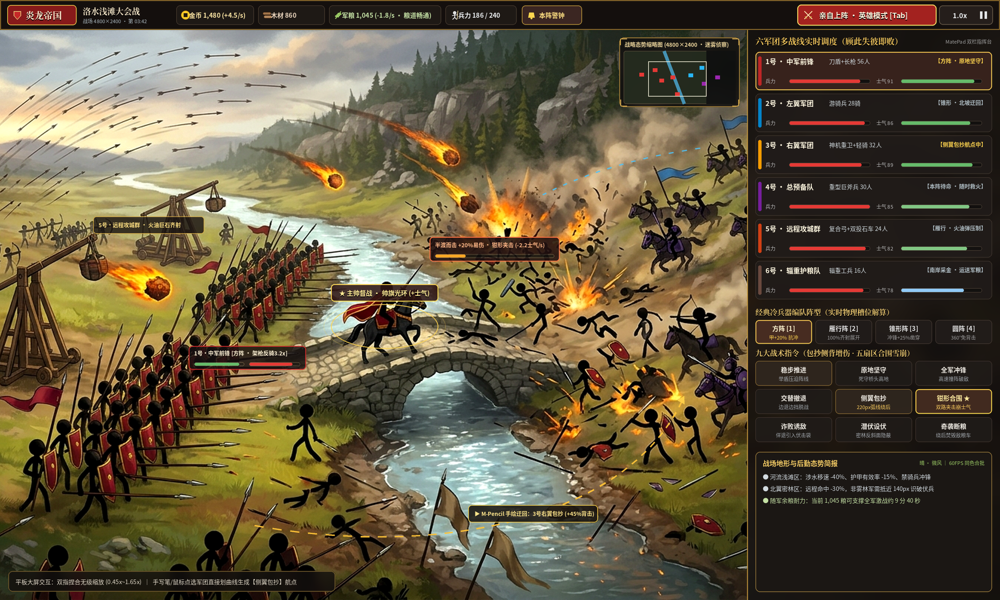
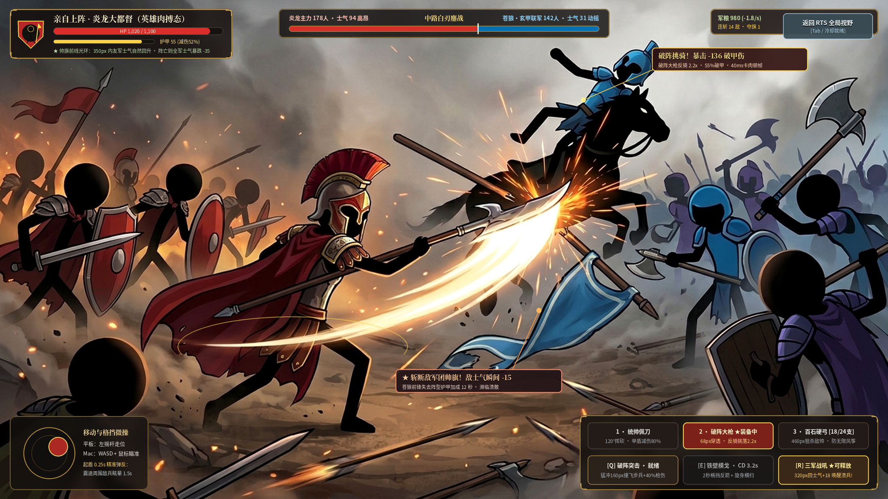
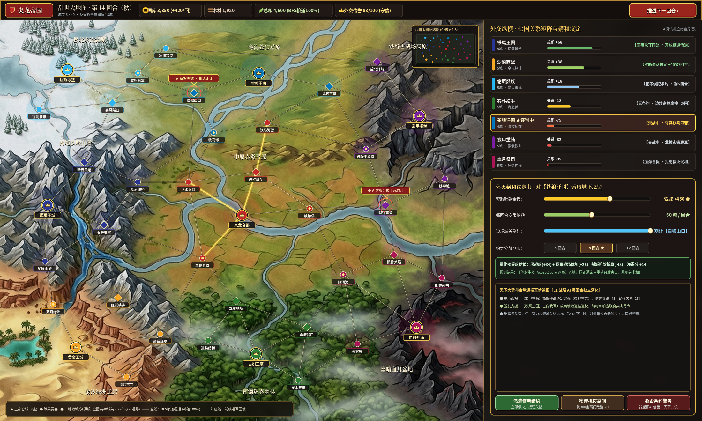
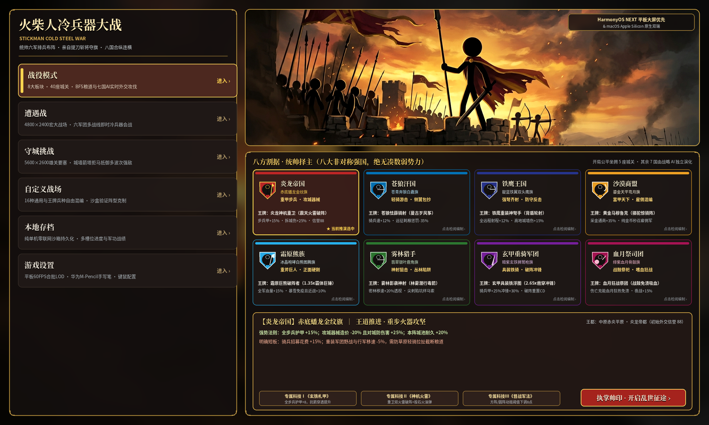

# 《火柴人冷兵器大战》（Stickman Cold Steel War）游戏实机概念与界面预览图集

本图集严格依据 [`DESIGN.md`](../../DESIGN.md)、`FactionConfig.ets`、`UnitConfig.ets` 与 `CampaignMapConfig.ets` 单点真相源制作，对应 **华为鸿蒙平板（MatePad 横屏双栏）** 与 **macOS Apple Silicon 原生版** 四大核心实机场景：

---

## 1. 真实冷兵器大战 · 六军团多战线调度与侧翼包抄合围（RTS 统帅全局视野）
- **4800×2400 宏大战场**：火柴人士兵真刀真枪骨骼动作拼杀（刀盾方阵架枪迎骑、后排复合弓漫天抛射、双配重投石车火油巨石砸阵、伤亡遗骸与断旗留存）。
- **硬核战术兑现**：中央石桥主帅督战光环、渡河【半渡而击 +20% 易伤】、南北走廊【钳形夹击 -2.2 士气/s】、华为 M-Pencil 手写笔/鼠标划曲线生成【侧翼包抄 +45% 背击】航点，配合右侧六军团状态、四阵型与九大战术指令台。

---

## 2. 主帅亲自上阵 · 提枪破阵挑骑与斩旗夺帅（英雄肉搏视角）
- **双视角一键切换**：随时由 RTS 统帅视角切入前线英雄肉搏模式，操控主帅冲入万军丛中挥砍格挡。
- **操作实感拉满**：三兵刃实时切换（统帅佩刀盾反 / 破阵大枪反骑挑落 2.2x / 百石硬弓 24 支箭袋限制）与三大战技（破阵突击、铁壁横戈、三军战吼唤醒溃兵），亲手挑落敌骑、斩断敌军团帅旗直接打崩敌阵士气。

---

## 3. 八大地理板块 · 40 座城关 · BFS 粮道与外交媾和议定（战略大地图双栏）
- **1:1 真实拓扑映射**：完整绘制 `CampaignMapConfig.ets` 全部 **8 大生态板块、40 座王都/雄关/仓城节点与 78 条对称双向道路**，直观呈现金色 **BFS 粮道补给线** 与前线围攻/AI 诸侯混战态势。
- **合纵连横与量化媾和**：右侧常驻七国关系矩阵（`-100 ~ +100`）、军事攻守同盟借道、丝路通商，以及可调筹码（赔款金币、每回合岁币纳粮、割让边境城关、停战回合）的量化接受度议和面板与背盟信誉惩罚警告。

---

## 4. 游戏主菜单与八大非对称强国总览（平板 / Mac 宽屏双栏）
- **左导航 + 右总览大屏布局**：左侧提供战役、遭遇战、守城挑战、自定义战场、本地存档、游戏设置六大宽幅高热区入口；右侧完整展示 **炎龙帝国、苍狼汗国、铁鹰王国、沙漠商盟、霜原熊族、雾林猎手、玄甲重骑军团、血月祭司团** 八大强国纹章、专属王牌兵种、强弱项法则与三阶专属科技。

